# I2-08 — Falhas de Autenticação e Broken Access Control

**Aluno:** João Gabriel G. Oliveira
**Disciplina:** Segurança e Teste de Software — IDP · **Prof.:** Fabricio Santana

Resolução dos desafios do **OWASP Juice Shop** e dos labs do **PortSwigger** (Authentication + Broken Access Control). Usei navegador, DevTools, `curl` e o Burp Suite conforme cada caso pedia.

---

## 1. OWASP Juice Shop

| # | Desafio | Status |
|---|---------|:------:|
| A1 | Login como admin sem SQLi | ✅ |
| A2 | Acessar a seção de administração | ✅ |
| A3 | Remover todo feedback de 5 estrelas | ✅ |
| A4 | Ver o carrinho de outro usuário | ✅ |

### A1 — Login do admin sem SQL Injection
A conta de admin usa uma senha fraca e conhecida (`admin123`). Loguei com `admin@juice-sh.op` / `admin123` sem precisar de injection.

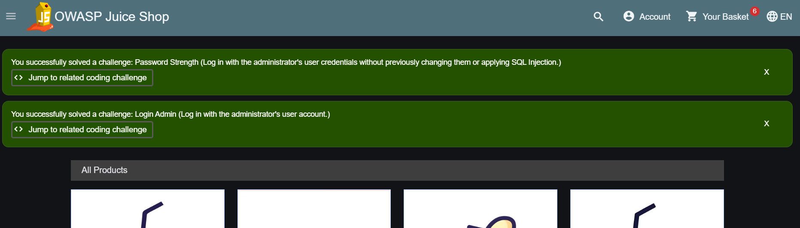

### A2 — Seção de administração
O painel de admin existe numa rota não-linkada. Descobri o caminho no JS da aplicação e acessei `/#/administration` já logado como admin.

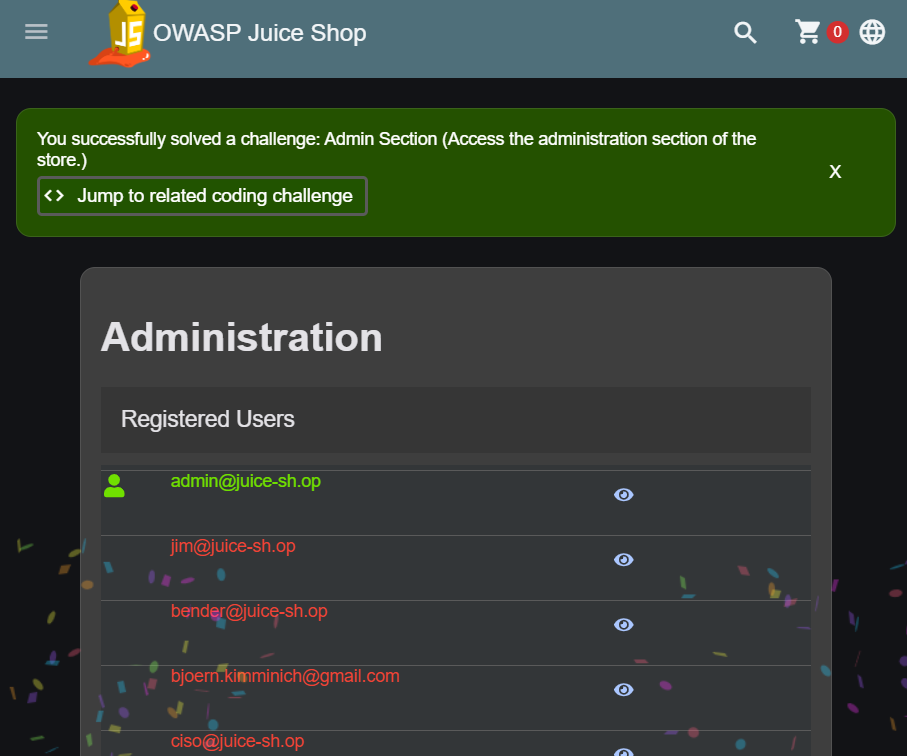

### A3 — Remover feedback de 5 estrelas
Dentro do painel de administração, apaguei todos os comentários com avaliação 5 estrelas.

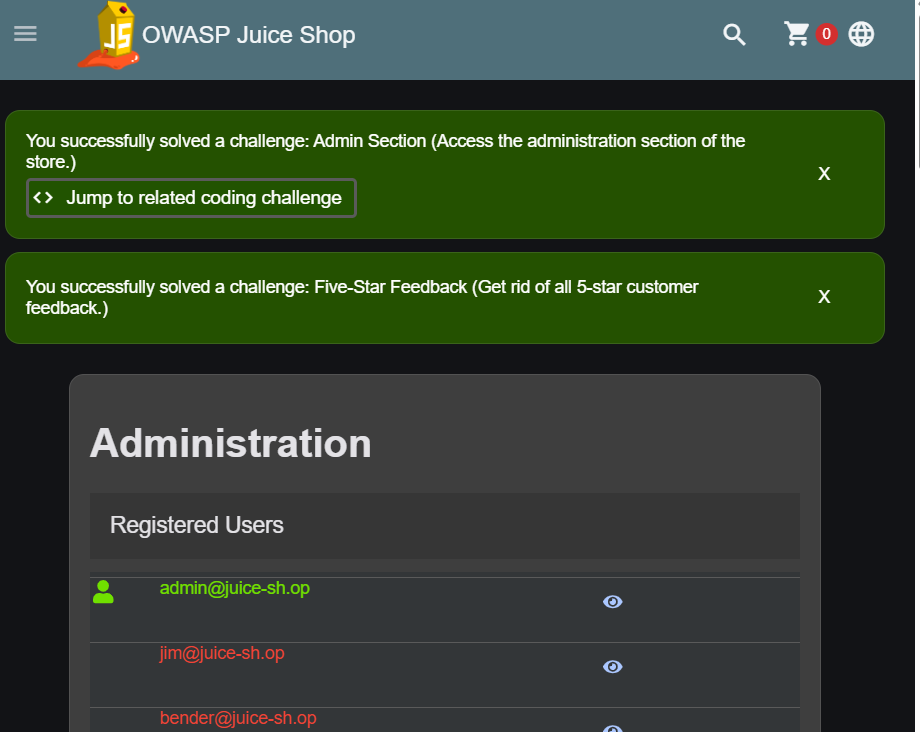

### A4 — Carrinho de outro usuário
A API de carrinho não checa o dono. Com o token no `localStorage`, fiz um `fetch` em `/rest/basket/2` e li o carrinho de outro usuário.

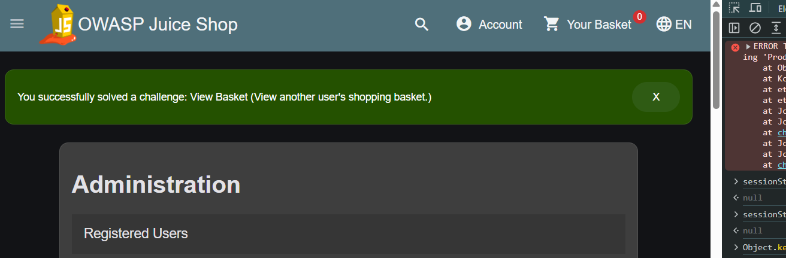

---

## 2. PortSwigger — Authentication

| # | Laboratório | Status |
|---|-------------|:------:|
| B1 | Username enumeration via different responses | ✅ |
| B2 | 2FA simple bypass | ✅ |
| B3 | Password reset broken logic | ✅ |

### B1 — Username enumeration via different responses
A resposta para um usuário válido tinha tamanho diferente da de um inválido. Usei o **Intruder** pra achar o username certo pela diferença de tamanho e depois a senha pelo status `302`.

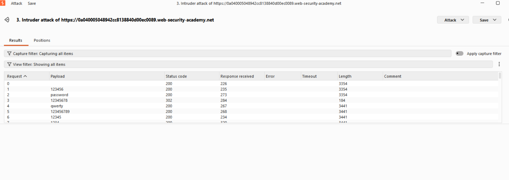
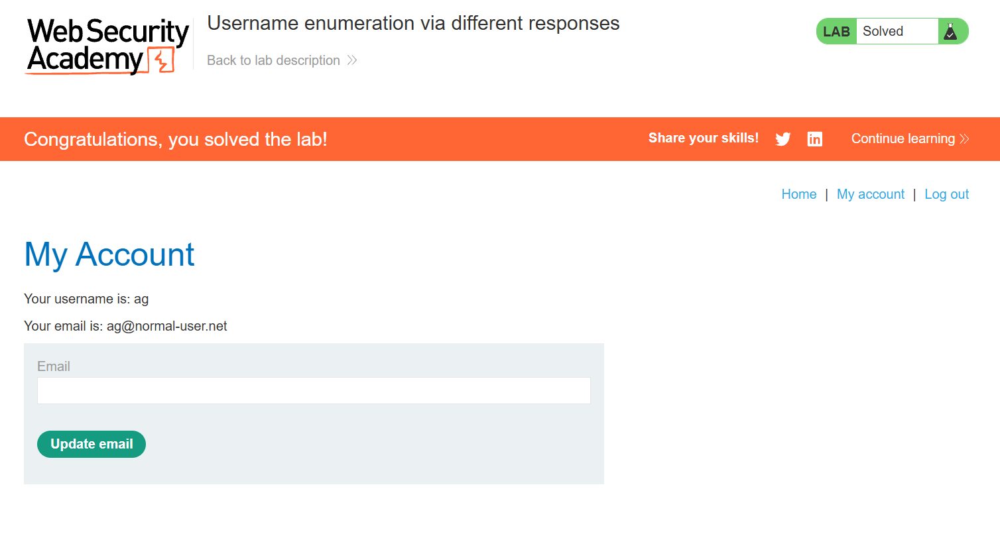

### B2 — 2FA simple bypass
Depois de passar da senha, em vez de preencher o código 2FA, naveguei direto pra `/my-account`. O app não exigia o 2FA concluído.

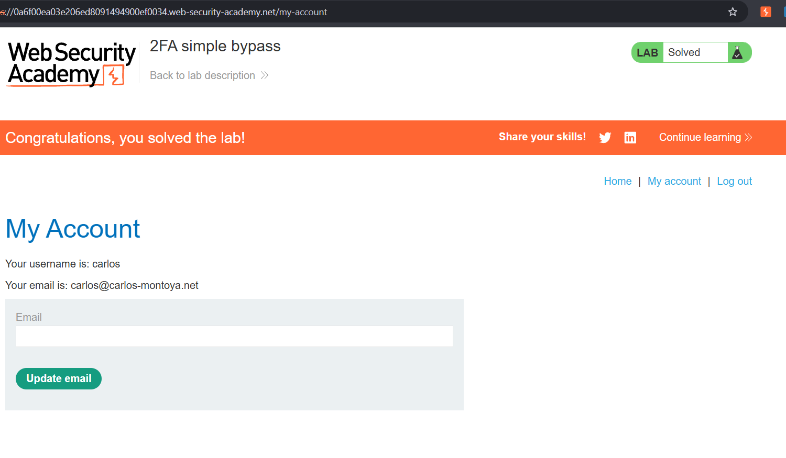

### B3 — Password reset broken logic
O reset amarra a nova senha a um token, mas o `username` vai solto no corpo da requisição. No **Repeater** troquei `username=wiener` por `username=carlos`, resetando a senha dele.

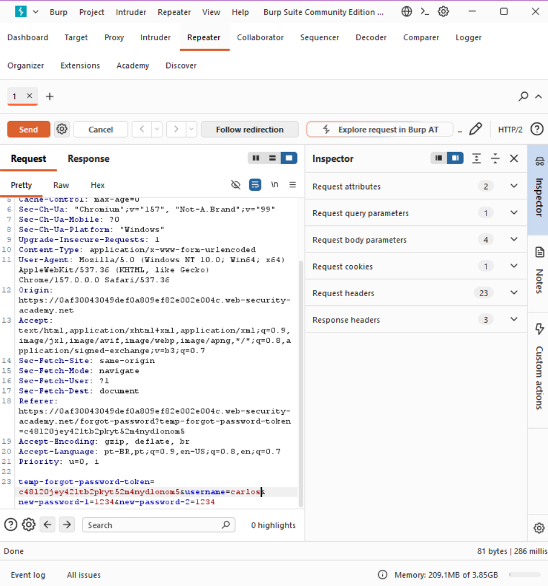
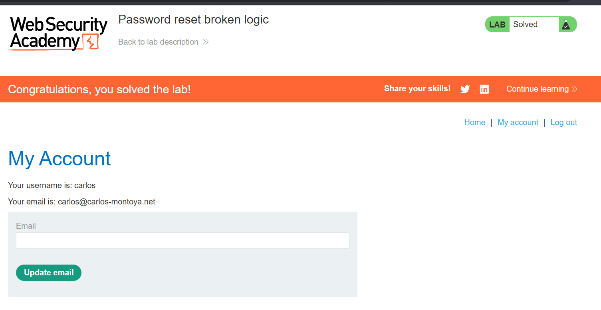

---

## 3. PortSwigger — Broken Access Control

| # | Laboratório | Status |
|---|-------------|:------:|
| C1 | Unprotected admin functionality | ✅ |
| C2 | Unprotected admin functionality with unpredictable URL | ✅ |
| C3 | User role controlled by request parameter | ✅ |
| C4 | User role can be modified in user profile | ✅ |
| C5 | User ID controlled by request parameter | ✅ |
| C6 | ...with unpredictable user IDs | ✅ |
| C7 | ...with data leakage in redirect | ✅ |
| C8 | ...with password disclosure | ✅ |
| C9 | Insecure direct object references | ✅ |

### C1 — Unprotected admin functionality
O caminho do painel estava exposto no `/robots.txt`. Acessei `/administrator-panel` e apaguei o carlos.

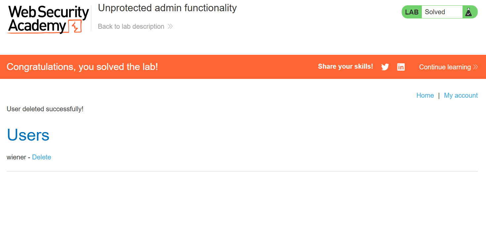

### C2 — ...with unpredictable URL
Aqui o caminho não estava no robots.txt, mas sim no JavaScript da página (`/admin-3aow6i`). Acessei direto e apaguei o carlos.

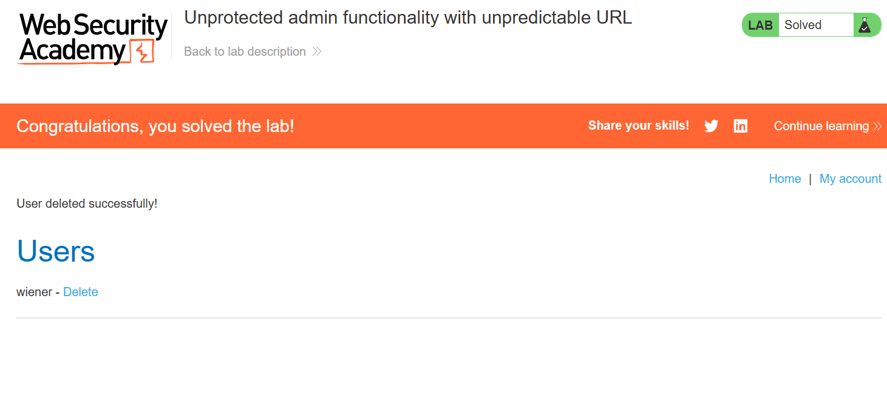

### C3 — User role controlled by request parameter
O acesso ao `/admin` é controlado por um cookie `Admin=false`. Troquei pra `Admin=true` pelo DevTools e o painel liberou.

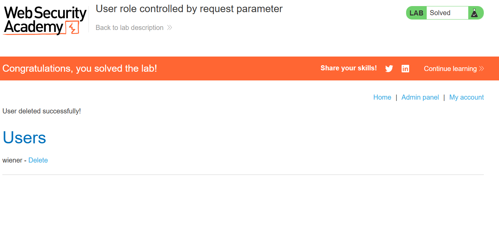

### C4 — User role can be modified in user profile
A função de atualizar email aceita um campo escondido `roleid`. Mandei o request com `"roleid":2` e virei admin.

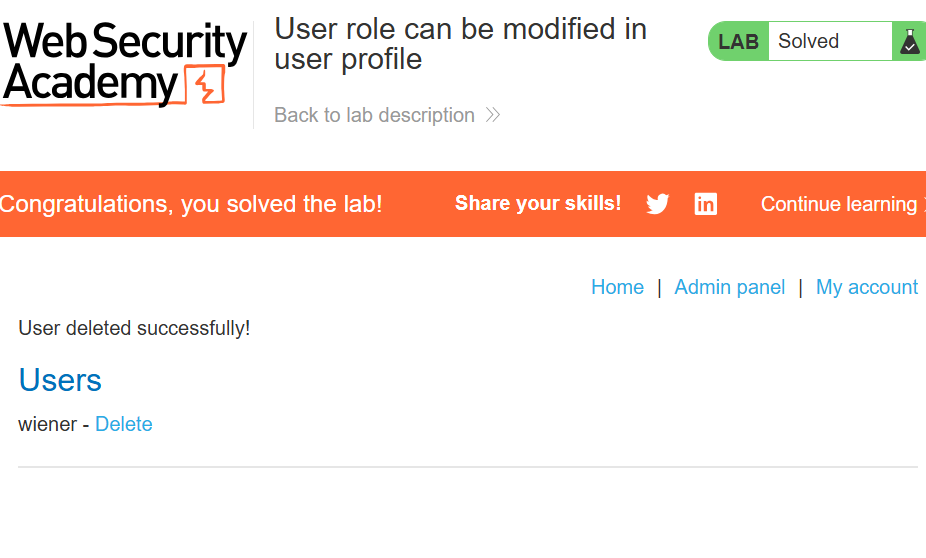

### C5 — User ID controlled by request parameter
A página de conta usa `?id=wiener`. Troquei pra `?id=carlos` e li a API key dele.

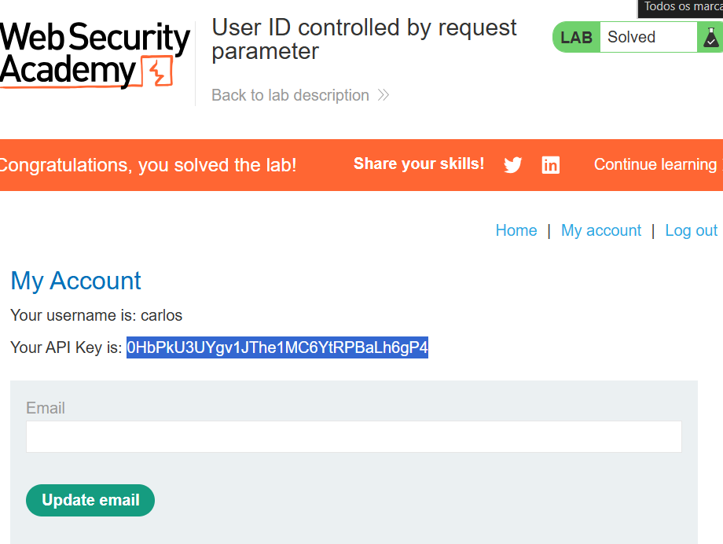

### C6 — ...with unpredictable user IDs
Igual ao C5, mas o ID é um GUID. Peguei o GUID do carlos num post do blog e usei em `/my-account?id=<guid>`.

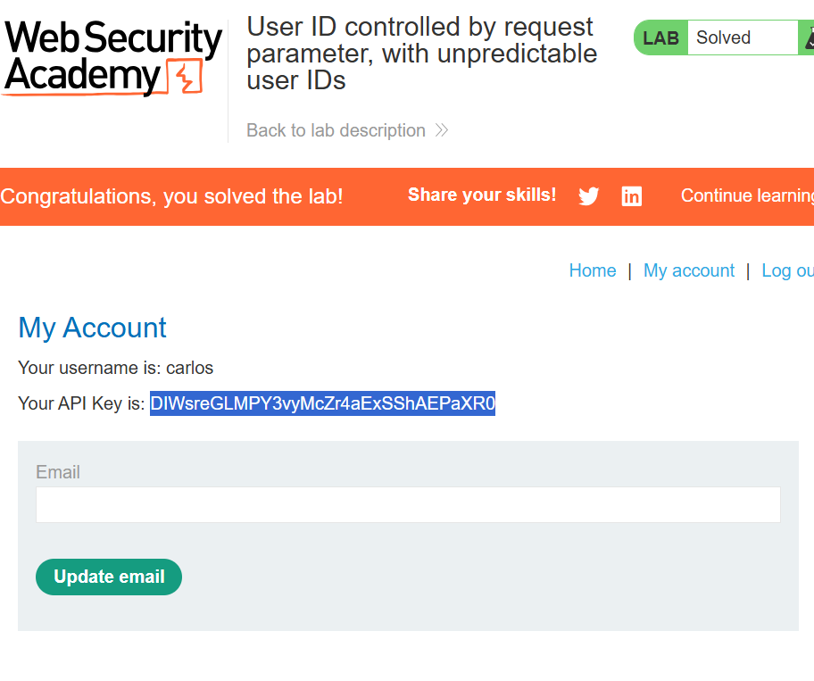

### C7 — ...with data leakage in redirect
Ao acessar a conta do carlos, o servidor redireciona pro login mas vaza a API key no corpo do `302`. O navegador esconde, então usei `curl` sem seguir o redirect pra ler a chave.

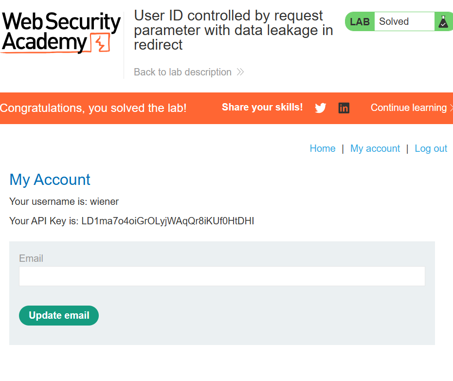

### C8 — ...with password disclosure
A página de conta traz a senha preenchida num campo mascarado. Abri `/my-account?id=administrator`, li a senha no código-fonte e loguei como administrador.

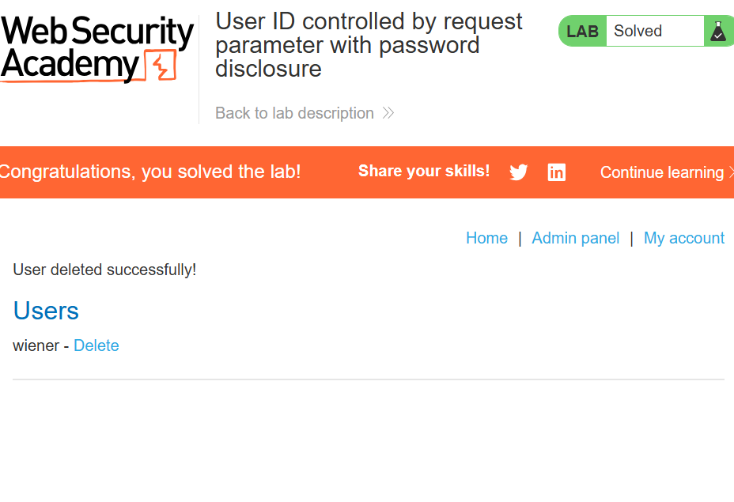

### C9 — Insecure direct object references
Os transcripts do chat ficam em arquivos numerados (`/download-transcript/N.txt`). Troquei o número e abri o transcript do carlos, que continha a senha dele.

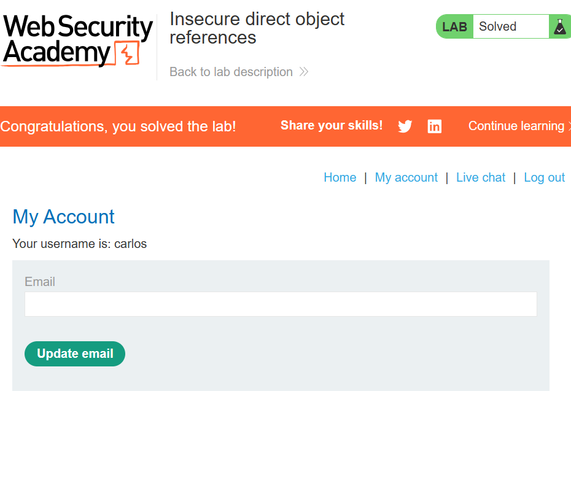
