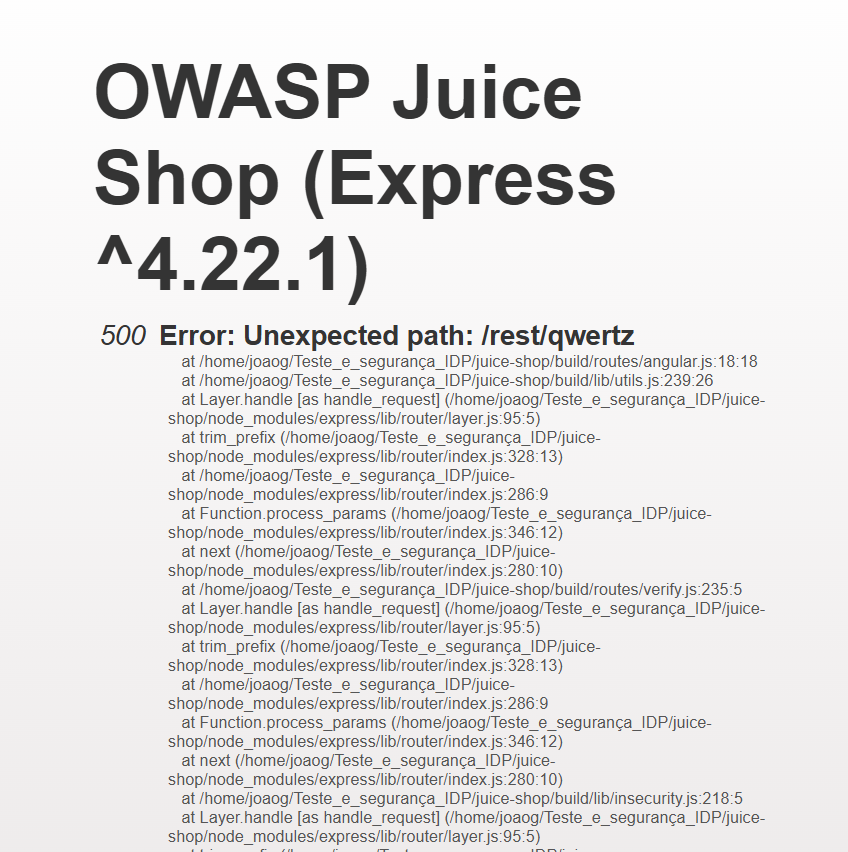
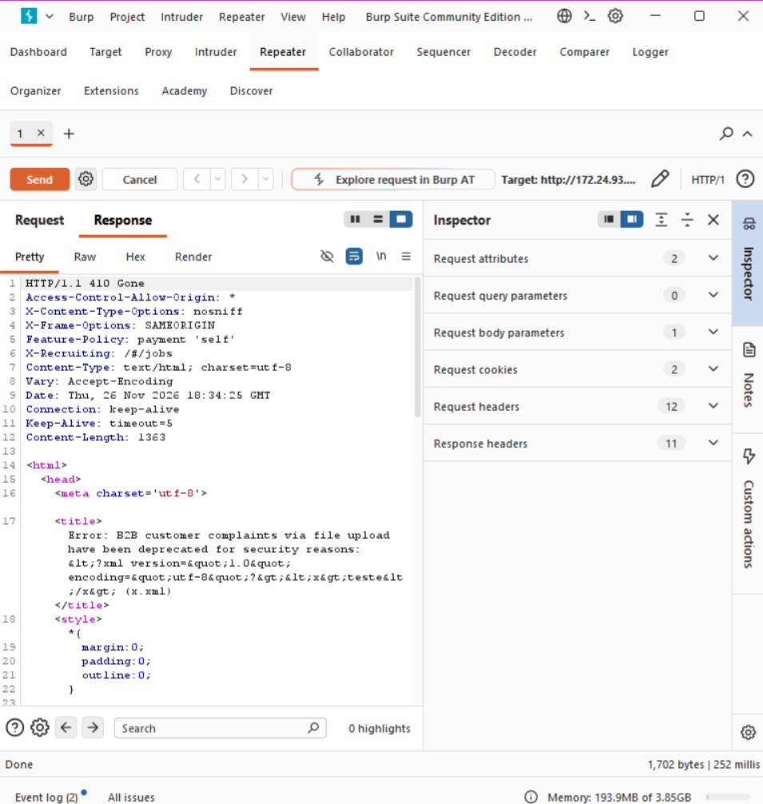
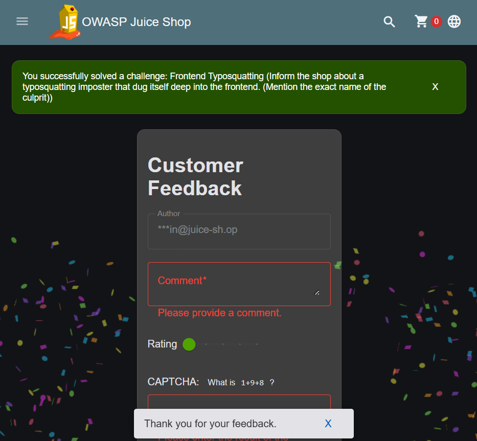
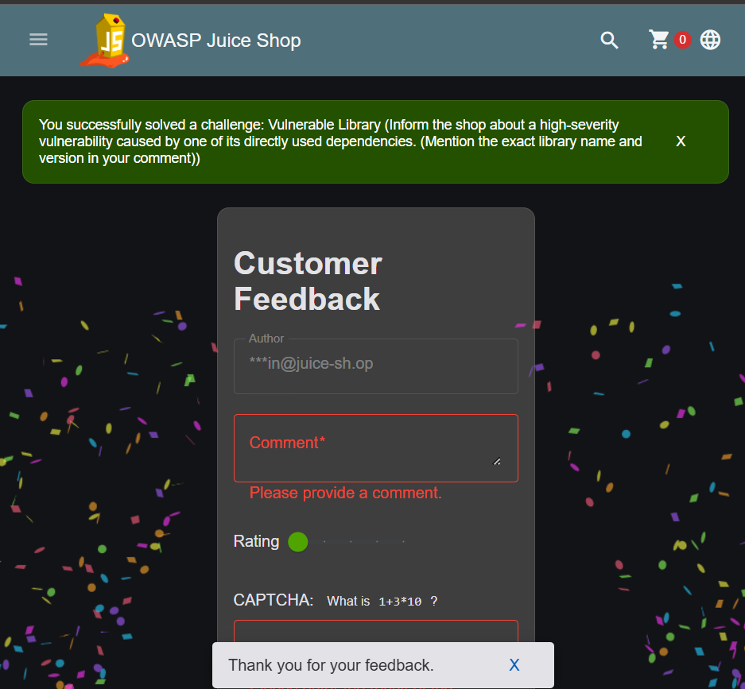
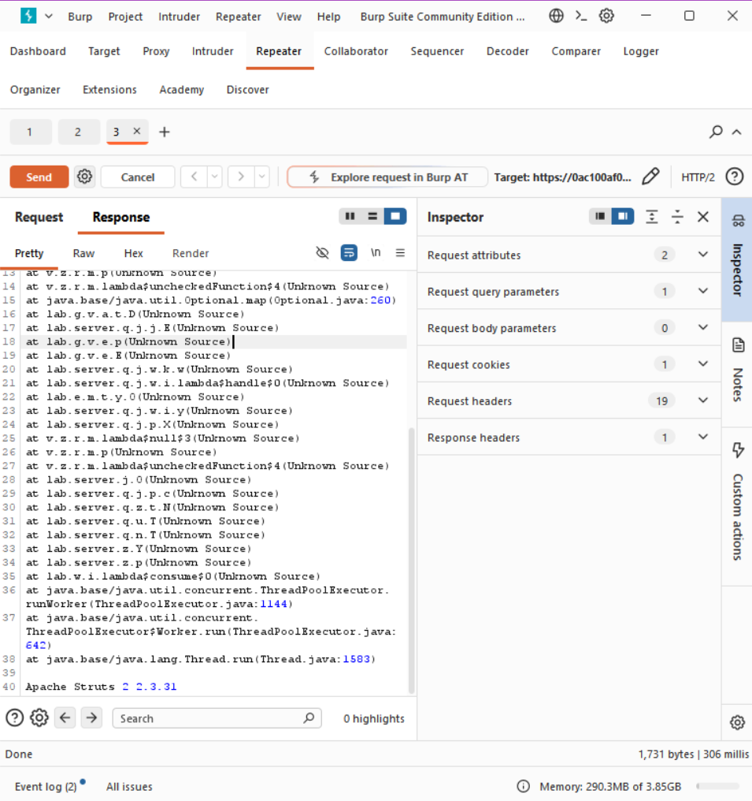
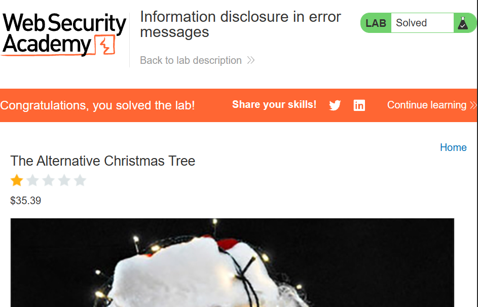
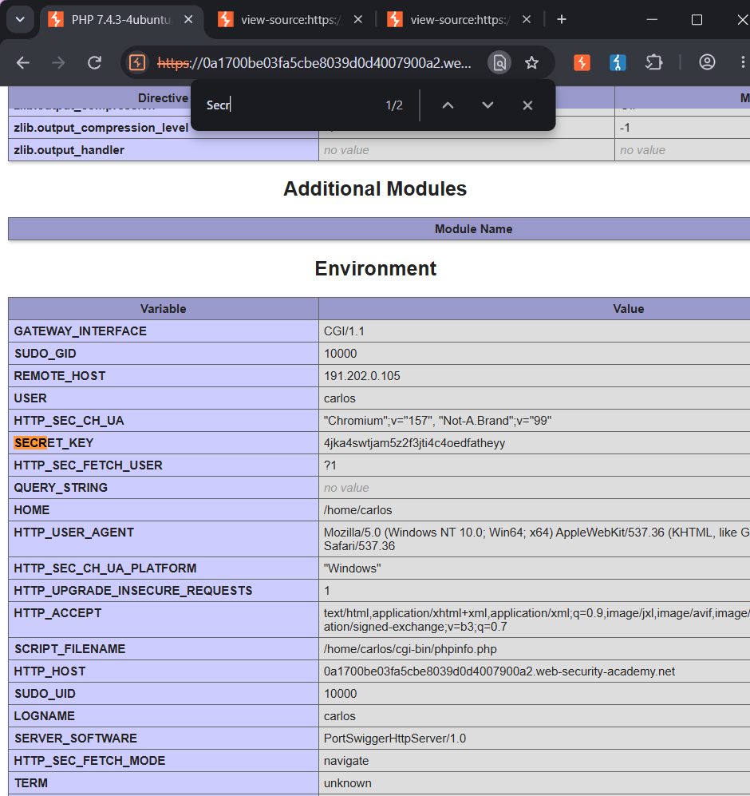
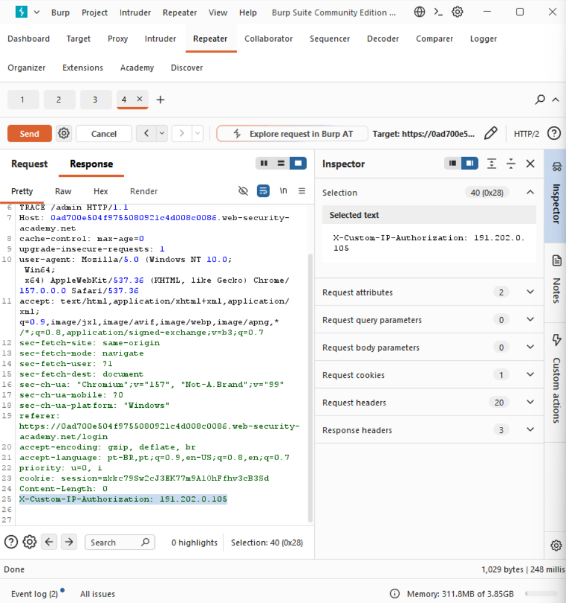
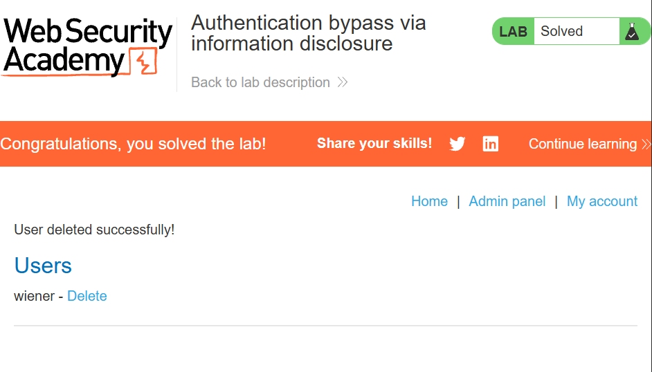

# I2-09 — Security Misconfiguration, Vulnerable and Outdated Components e Security Logging

**Aluno:** João Gabriel G. Oliveira
**Disciplina:** Segurança e Teste de Software — IDP · **Prof.:** Fabricio Santana

Resolução dos desafios do **OWASP Juice Shop** (Security Misconfiguration + Vulnerable and Outdated Components) e dos labs de **Information Disclosure** do **PortSwigger**. Usei navegador, DevTools, `curl` e o Burp Suite conforme cada caso pedia.

---

## 1. OWASP Juice Shop — Security Misconfiguration

| # | Desafio | Status |
|---|---------|:------:|
| A1 | Provoke an error that is neither very gracefully nor consistently handled | ✅ |
| A2 | Use a deprecated B2B interface that was not properly shut down | ✅ |

### A1 — Error Handling
A API não trata rotas inexistentes de forma consistente. Ao acessar um endpoint REST que não existe, o Express devolve a página de erro padrão com o stack trace, que expõe caminhos internos do servidor e as bibliotecas usadas.

```
GET /rest/qwertz
```


### A2 — Deprecated Interface
A página de reclamação (`/#/complain`) só aceita `.pdf` e `.zip` no front-end, mas o servidor ainda processa upload de `.xml`, resto de uma antiga interface B2B. Interceptei o upload no Burp Suite, troquei o arquivo enviado por um `.xml` (`filename="x.xml"`, `Content-Type: application/xml`) e reenviei pelo Repeater. O servidor respondeu com `410` ("B2B customer complaints via file upload have been deprecated"), mas processou o arquivo mesmo assim.

```
Content-Disposition: form-data; name="file"; filename="x.xml"
Content-Type: application/xml

<?xml version="1.0"?><x>teste</x>
```


---

## 2. OWASP Juice Shop — Vulnerable and Outdated Components

| # | Desafio | Status |
|---|---------|:------:|
| B1 | Inform the shop about a typosquatting imposter that dug itself deep into the frontend | ✅ |
| B2 | Inform the shop about a vulnerable library it is using | ✅ |

### B1 — Frontend Typosquatting
Olhando as dependências do front-end (`/3rdpartylicenses.txt` e o bundle JS), aparece o pacote **`ngy-cookie`**, um impostor com nome parecido com o legítimo `ngx-cookie`. Informei a loja pelo formulário de feedback (`/#/contact`) citando o pacote.

```
Comentário: O front-end usa o pacote typosquatting ngy-cookie no lugar de ngx-cookie.
```


### B2 — Vulnerable Library
O back-end usa uma dependência direta desatualizada com vulnerabilidade de alta severidade conhecida: a **`sanitize-html` 1.4.2**, que tem um bypass de sanitização que permite XSS. Informei a loja pelo formulário de feedback (`/#/contact`) citando o nome e a versão exatos da biblioteca.

```
Comentário: A loja usa sanitize-html 1.4.2, que tem vulnerabilidade conhecida de XSS.
```


---

## 3. PortSwigger — Information Disclosure (Security Logging)

| # | Laboratório | Status |
|---|-------------|:------:|
| C1 | Information disclosure in error messages | ✅ |
| C2 | Information disclosure on debug page | ✅ |
| C3 | Source code disclosure via backup files | ✅ |
| C4 | Authentication bypass via information disclosure | ✅ |

### C1 — Information disclosure in error messages
Troquei o `productId` numérico por uma string. A aplicação não tratou a exceção e devolveu o stack trace completo, que no final mostra o framework e a versão: **Apache Struts 2 2.3.31**. Submeti essa versão como resposta.

```
GET /product?productId=x
```



### C2 — Information disclosure on debug page
No código-fonte da home tinha um comentário HTML apontando para uma página de debug (`/cgi-bin/phpinfo.php`). A página estava acessível e o `phpinfo()` listava as variáveis de ambiente, incluindo a `SECRET_KEY`, que submeti como resposta.

```
GET /cgi-bin/phpinfo.php
```



### C3 — Source code disclosure via backup files
O `/robots.txt` tinha um `Disallow: /backup`. O diretório listava o arquivo `ProductTemplate.java.bak`, com o código-fonte da aplicação e a senha do banco PostgreSQL escrita direto no código. Submeti a senha como resposta.

```
GET /backup/ProductTemplate.java.bak
```


### C4 — Authentication bypass via information disclosure
O `/admin` só libera acesso para usuários locais. Mandei uma requisição `TRACE /admin` e a resposta ecoou um header que o front-end injeta, `X-Custom-IP-Authorization` com o meu IP. Configurei o **Match and Replace** do Burp para enviar esse header com `127.0.0.1` em todas as requisições. O servidor passou a me tratar como local, o painel liberou e apaguei o `carlos`.


