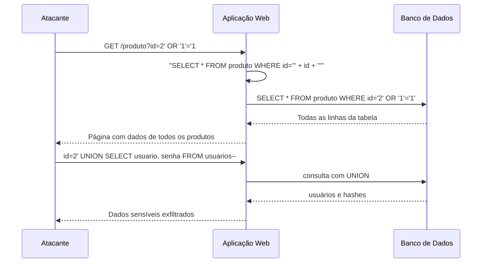

# Prompt 11: Injection (A03:2021)

**Aluno:** Guilherme Abade
**Referências:** [OWASP A03:2021](https://owasp.org/Top10/A03_2021-Injection/) · [WSTG - SQL Injection](https://owasp.org/www-project-web-security-testing-guide/latest/4-Web_Application_Security_Testing/07-Input_Validation_Testing/05-Testing_for_SQL_Injection) · [sqlmap](https://sqlmap.org) · [XSStrike](https://github.com/s0md3v/XSStrike)

Os comandos de `sqlmap` e `XSStrike` e as saídas apresentadas constituem roteiros para um laboratório local e controlado, como uma aplicação própria em `localhost`, o DVWA, o Juice Shop ou o WebGoat. Tais ferramentas só podem ser utilizadas em sistemas próprios ou mediante autorização formal, uma vez que o acesso não autorizado a sistemas é crime no Brasil, nos termos da Lei 12.737/2012.

## 1. Introdução

Segundo a OWASP, uma vulnerabilidade de injeção ocorre quando dados fornecidos pelo usuário são encaminhados a um interpretador como parte de um comando ou de uma consulta, sem validação, filtragem ou separação entre código e dados. Os interpretadores afetados incluem SQL, NoSQL, LDAP, o shell do sistema operacional, expressões OGNL e EL, XPath e o próprio HTML com JavaScript. Como o interpretador não distingue instrução de dado, acaba por executar o conteúdo injetado pelo atacante.

A categoria permanece no Top 10 de 2021 por sua prevalência: 94% das aplicações testadas apresentaram alguma forma de injeção, com 33 CWEs mapeadas e mais de 274 mil ocorrências. Em 2021 a injeção passou do primeiro para o terceiro lugar e incorporou o XSS, catalogado como CWE-79. Sua persistência decorre da existência de código legado baseado em concatenação de strings, de consultas dinâmicas em ORMs, de novas superfícies de ataque como GraphQL e NoSQL, e da ausência de testes de segurança no ciclo de desenvolvimento.

Afirmar que dados não confiáveis são interpretados como comandos significa que a aplicação monta a consulta unindo texto fixo e entrada do usuário. Quando essa entrada contém caracteres dotados de significado para o interpretador, como aspas, ponto e vírgula, hífens duplos ou cifrão, ela deixa de funcionar como valor e passa a alterar a estrutura do comando.

Os impactos mais comuns compreendem a exfiltração de dados, com a leitura de tabelas inteiras de usuários, hashes e cartões; a corrupção ou perda de dados, por meio de comandos `UPDATE`, `DELETE` ou `DROP` injetados; o desvio da autenticação, que permite o acesso sem senha; e o controle remoto, por execução de comandos no sistema operacional ou pela instalação de *webshells*. No caso específico do XSS, acrescenta-se o sequestro de sessão e a execução de ações em nome da vítima.

A OWASP relaciona diversos tipos de injeção, entre eles SQL, NoSQL, de comando de sistema operacional, LDAP, XPath, de ORM nas linguagens HQL e JPQL, de linguagem de expressão, de template no servidor, XSS, de cabeçalho por CRLF e de XML com XXE. O diagrama abaixo representa o ciclo de um ataque de injeção SQL.



## 2. Entendendo a injeção SQL

A manipulação da entrada afeta a consulta porque a aplicação espera um valor simples, como `42`, e recebe um fragmento de SQL, como `42 OR 1=1`. Dado que a consulta é montada por concatenação, esse fragmento modifica a cláusula `WHERE`, acrescenta um `UNION`, comenta o restante com `--` ou encadeia outro comando com ponto e vírgula.

O Web Security Testing Guide identifica como vetores de entrada testáveis os parâmetros `GET` na *query string* e `POST` em formulários, JSON ou XML; os cabeçalhos `User-Agent`, `Referer`, `X-Forwarded-For` e `Host`, quando gravados ou usados em consultas; os cookies, a exemplo de `lang`, `sessionId` e `tracking_id`; e ainda partes do caminho, campos ocultos e nomes de arquivos enviados.

Os tipos de ataque distinguem-se pela técnica empregada. No ataque tautológico, injeta-se uma condição sempre verdadeira, como `' OR 1=1 --`, de modo que a cláusula `WHERE` aceite todas as linhas. Na injeção *piggy-backed*, ou *stacked queries*, encadeia-se outro comando por ponto e vírgula, por exemplo `1; DROP TABLE usuarios --`, o que depende de o driver permitir múltiplas instruções. Na injeção cega do tipo *boolean-based*, a aplicação não exibe dados nem erros, mas responde de forma diferente conforme a condição seja verdadeira ou falsa, permitindo a extração bit a bit. Na variante *time-based*, recorre-se a atrasos, como `SLEEP(5)`, de maneira que uma demora confirme a condição. Há também as técnicas *union-based* e *error-based*, que se valem respectivamente de `UNION SELECT` e das mensagens de erro do SGBD para trazer dados na resposta.

A consulta a seguir, construída com `Statement` e concatenação, ilustra o problema.

```java
public boolean login(Connection conn, String usuario, String senha) throws SQLException {
    String sql = "SELECT id FROM usuarios WHERE usuario = '" + usuario +
                 "' AND senha = '" + senha + "'";
    try (Statement st = conn.createStatement();
         ResultSet rs = st.executeQuery(sql)) {
        return rs.next();
    }
}
```

Ao receber a entrada `' OR 1=1 --` no campo de usuário, a consulta resultante assume a forma seguinte.

```sql
SELECT id FROM usuarios WHERE usuario = '' OR 1=1 --' AND senha = '...'
```

Nesse caso, a aspa fecha a string do usuário, a condição `OR 1=1` torna a cláusula `WHERE` sempre verdadeira e o `--` comenta o restante, de modo que a verificação de senha desaparece. O resultado contém todas as linhas, `rs.next()` retorna verdadeiro e o atacante obtém acesso, normalmente como o primeiro usuário da tabela, com frequência o administrador.

## 3. Prevenção com `PreparedStatement`

O `PreparedStatement` com *bind parameters* evita a injeção porque a consulta é pré-compilada com marcadores `?` e enviada ao banco de forma separada dos valores. Como o SGBD já conhece a estrutura do comando, o conteúdo que chega depois é tratado sempre como dado, nunca como instrução. Dessa maneira, uma entrada como `' OR 1=1 --` passa a ser apenas um nome de usuário literal inexistente.

Convém distinguir validação de entrada e parametrização da consulta. A parametrização é a defesa primária, pois separa código de dados e resolve a injeção de forma estrutural. A validação de tipo, tamanho, formato e lista de valores permitidos é defesa complementar, que reduz a superfície de ataque, mas não basta isoladamente, dado que sempre pode surgir um caractere ou uma codificação não prevista. A validação torna-se necessária, porém, onde não cabe parametrização, como no nome de coluna de uma cláusula `ORDER BY`, hipótese em que se recorre a uma lista de valores permitidos.

O uso de ORMs não elimina por completo o risco. Frameworks como JPA e Hibernate parametrizam quando empregados corretamente, mas ainda admitem injeção em JPQL ou HQL concatenado, em consultas nativas construídas por concatenação, em nomes de coluna dinâmicos e em critérios montados a partir de strings. A função de login reescrita a seguir aplica a parametrização e verifica a senha por hash.

```java
public Optional<Long> login(Connection conn, String usuario, String senha) throws SQLException {
    String sql = "SELECT id, senha_hash FROM usuarios WHERE usuario = ?";
    try (PreparedStatement ps = conn.prepareStatement(sql)) {
        ps.setString(1, usuario);
        try (ResultSet rs = ps.executeQuery()) {
            if (rs.next() && BCrypt.checkpw(senha, rs.getString("senha_hash"))) {
                return Optional.of(rs.getLong("id"));
            }
        }
    }
    return Optional.empty();
}
```

A simulação de um mesmo conjunto de entradas nas duas versões evidencia a diferença de comportamento.

| Entrada (usuário / senha) | Com `Statement` | Com `PreparedStatement` |
|---|---|---|
| `guilherme` / correta | Autentica | Autentica |
| `guilherme` / incorreta | Rejeita | Rejeita |
| `' OR 1=1 --` / `x` | Autentica como primeiro usuário | Rejeita, busca usuário literal inexistente |
| `admin'--` / `x` | Autentica como administrador | Rejeita |
| `x'; DROP TABLE usuarios;--` | Pode apagar a tabela, se houver *stacked queries* | Rejeita, tabela preservada |

Um teste automatizado com banco em memória demonstra o contraste entre as implementações.

```java
@Test
void tautologiaNaoBurlaPreparedStatement() throws Exception {
    assertTrue(repoVulneravel.login(conn, "' OR 1=1 --", "x"));      // vulnerável
    assertTrue(repoSeguro.login(conn, "' OR 1=1 --", "x").isEmpty()); // corrigido
}
```

## 4. Técnicas de teste para injeção SQL

Diversos sinais revelam a presença de uma falha de injeção. Entre eles estão as mensagens de erro do SGBD exibidas na resposta, o retorno de código HTTP 500 ao inserir uma aspa simples com normalização ao inserir aspas duplas, respostas distintas para as condições `AND 1=1` e `AND 1=2`, atrasos proporcionais ao valor de um `SLEEP` injetado e a presença de mais linhas que o esperado diante de uma tautologia.

As técnicas de teste seguem uma progressão. A tautologia verifica se a lista inteira aparece. A determinação do número de colunas recorre a `ORDER BY` incremental ou a `UNION SELECT NULL`. A técnica `UNION SELECT` traz dados na própria página. A técnica temporal utiliza `SLEEP`, `pg_sleep` ou `WAITFOR DELAY`, conforme o SGBD. Entre as ferramentas de apoio figuram o sqlmap, o Burp Suite, o OWASP ZAP e o Ghauri, além de analisadores estáticos como SonarQube, Semgrep e CodeQL, que localizam concatenação no código.

O endpoint vulnerável a seguir, em Spring Boot com JDBC, serve de alvo de laboratório.

```java
@RestController
class UsuarioControllerVulneravel {
    private final JdbcTemplate jdbc;
    UsuarioControllerVulneravel(JdbcTemplate jdbc) { this.jdbc = jdbc; }

    @GetMapping("/usuario")
    List<Map<String, Object>> buscar(@RequestParam String id) {
        return jdbc.queryForList("SELECT id, nome, email FROM usuarios WHERE id = '" + id + "'");
    }
}
```

| Entrada em `id` | SQL resultante | Resultado esperado |
|---|---|---|
| `1` | `... WHERE id = '1'` | Um usuário |
| `' OR 'a'='a` | `... WHERE id = '' OR 'a'='a'` | Todos os usuários |
| `' UNION SELECT null, version(), null --` | `... UNION SELECT null, version(), null` | Versão do SGBD no campo nome |

A correção substitui o tipo do parâmetro e aplica o *bind*.

```java
@GetMapping("/usuario")
ResponseEntity<Map<String, Object>> buscar(@RequestParam long id) {   // tipo forte
    List<Map<String, Object>> r = jdbc.queryForList(
        "SELECT id, nome, email FROM usuarios WHERE id = ?", id);     // bind
    return r.isEmpty() ? ResponseEntity.notFound().build() : ResponseEntity.ok(r.get(0));
}
```

Após a correção, a entrada `' OR 'a'='a` passa a gerar `400 Bad Request`, pois não se converte em `long`; ainda que o parâmetro permanecesse como texto, o marcador trataria o valor como literal e retornaria `404`.

## 5. Testando com SQLMap

O sqlmap realiza detecção automática ao submeter cada parâmetro a payloads de diferentes técnicas e comparar as respostas com uma referência de conteúdo, código HTTP, tamanho e tempo. Confirmada a injeção, a ferramenta identifica o SGBD por *fingerprint* e passa à extração de dados.

As técnicas disponíveis correspondem às letras do parâmetro `--technique`: `B` para a cega baseada em valor booleano, `E` para a baseada em erro, `U` para `UNION`, `S` para *stacked queries*, `T` para a cega baseada em tempo e `Q` para consultas em linha. Entre os parâmetros principais estão `-u` para a URL, `--data` para o corpo `POST`, `--cookie`, `-H` para cabeçalhos, `-p` para indicar o parâmetro e `-r` para uma requisição capturada no Burp. O roteiro abaixo exercita diferentes técnicas sobre a aplicação vulnerável e valida a correção.

```bash
# 1. Subir a aplicação vulnerável acima em localhost:8080
# 2. Somente boolean-based
sqlmap -u "http://localhost:8080/usuario?id=1" -p id --technique=B --batch
# 3. Somente time-based
sqlmap -u "http://localhost:8080/usuario?id=1" -p id --technique=T --batch
# 4. Aplicar a correção (PreparedStatement e tipo long), reiniciar e repetir
sqlmap -u "http://localhost:8080/usuario?id=1" -p id --batch --level=5 --risk=3
```

Antes da correção, a ferramenta tende a indicar que o parâmetro `id` é injetável, listando o payload de cada técnica e o SGBD identificado; a técnica temporal mostra-se bem mais lenta, pois cada bit custa alguns segundos. Depois da correção, o resultado esperado é a ausência de parâmetros injetáveis.

## 6. Casos reais e impactos

O ataque à operadora TalkTalk, no Reino Unido em 2015, explorou páginas web legadas herdadas da aquisição da Tiscali, que acessavam o banco de clientes por meio de injeção SQL automatizada. Cerca de 157 mil clientes foram afetados, dos quais aproximadamente 15,6 mil tiveram dados bancários expostos. Faltavam à empresa o inventário de ativos, visto que as páginas antigas eram desconhecidas, a atualização do SGBD, a varredura de vulnerabilidades, a proteção por WAF e o monitoramento; havia ainda alertas anteriores de ataques semelhantes que foram ignorados. Como consequência, aplicou-se uma multa de 400 mil libras, a empresa perdeu cerca de 100 mil clientes, estimou-se um custo de 60 milhões de libras e a direção foi convocada pelo Parlamento.

O quadro a seguir sintetiza o vetor, a resposta e o impacto reputacional do caso.

| Vetor de ataque | Resposta da empresa | Impacto reputacional |
|---|---|---|
| Injeção SQL em página legada sem manutenção | Comunicação pública rápida, porém confusa quanto ao que vazou, com desligamento das páginas e investigação policial | Elevado, com perda de clientes, multa e imagem de negligência |

O incidente da Heartland Payment Systems, em 2008, teve origem em uma injeção SQL em uma aplicação web que serviu de porta de entrada para a instalação de *sniffers* na rede de processamento de cartões, comprometendo cerca de 130 milhões de cartões e resultando em mais de 140 milhões de dólares em acordos. A OWASP recomenda, para prevenir esses ataques, o uso de uma API segura e parametrizada, a validação positiva no servidor, o *escape* específico apenas onde não há parametrização possível, o emprego de `LIMIT` para reduzir o vazamento em massa, o menor privilégio no banco e a adoção de análise estática e dinâmica no pipeline.

## 7. Checklist de prevenção

O checklist a seguir consolida as recomendações da OWASP para prevenir injeções.

- [x] Utilizar sempre `PreparedStatement` ou ORM com parâmetros nomeados.
- [x] Nunca concatenar entrada em SQL, JPQL, HQL, LDAP ou comando de sistema operacional.
- [x] Aplicar lista de valores permitidos a identificadores dinâmicos, como a coluna e a direção de ordenação.
- [x] Validar tipo, tamanho e formato no servidor.
- [x] Conceder ao usuário do banco o menor privilégio, sem permissão de `DROP` nem acesso a outras bases.
- [x] Não expor ao cliente as mensagens de erro do SGBD.
- [x] Executar análise estática no pipeline e análise dinâmica em homologação.
- [x] Registrar e alertar sobre tentativas suspeitas.

O trecho de código reúne os três controles centrais: parametrização, validação e tratamento de erro sem exposição da estrutura do banco.

```java
// 1. PreparedStatement
try (PreparedStatement ps = conn.prepareStatement(
        "SELECT * FROM pedidos WHERE cliente_id = ? AND status = ?")) {
    ps.setLong(1, clienteId);
    ps.setString(2, status);
}

// 2. Validação com Regex e commons-validator
private static final Pattern STATUS = Pattern.compile("^(ABERTO|PAGO|ENVIADO)$");
if (!STATUS.matcher(status).matches()) throw new IllegalArgumentException("status inválido");
if (!EmailValidator.getInstance().isValid(email)) throw new IllegalArgumentException("e-mail inválido");

// Lista de valores permitidos para ORDER BY
private static final Set<String> COLUNAS = Set.of("nome", "data", "valor");
String coluna = COLUNAS.contains(ordem) ? ordem : "data";

// 3. Erros sem expor a estrutura do banco
try {
    repo.salvar(pedido);
} catch (DataAccessException e) {
    log.error("Falha ao salvar pedido cliente={} correlationId={}", clienteId, cid, e);
    throw new ResponseStatusException(HttpStatus.INTERNAL_SERVER_ERROR,
        "Não foi possível processar o pedido. Código: " + cid);
}
```

## 8. SQLMap como ferramenta de teste automatizado

O sqlmap é uma ferramenta de código aberto, escrita em Python, que automatiza a detecção e a exploração de injeção SQL. Entre suas funções estão o *fingerprint* do SGBD, a enumeração de bancos, tabelas e colunas, a extração de dados e, em determinados cenários, a leitura e a escrita de arquivos. Suporta as técnicas já descritas em SGBDs como MySQL, PostgreSQL, Oracle, SQL Server, SQLite e DB2. Diferencia-se de scanners genéricos, como ZAP, Nikto e Burp Scanner, por sua especialização, que o leva da detecção à exploração completa.

No comando `sqlmap -u "http://exemplo.com/item?id=1"`, o termo `sqlmap` invoca o programa, o `-u` indica a URL alvo e o parâmetro `id` constitui o ponto de injeção a ser testado, sendo as aspas necessárias para impedir que o shell interprete os caracteres especiais. Quanto aos parâmetros de agressividade, o `--level`, de 1 a 5, determina quantos pontos de injeção e payloads serão testados, passando a incluir cookies no nível 2 e cabeçalhos no nível 3; o `--risk`, de 1 a 3, controla a agressividade, de modo que o risco 3 abrange payloads com `OR` capazes de alterar dados; o `--batch` responde às perguntas com o padrão; e há ainda `--threads`, `--dbms` e `--random-agent`.

## 9. Detecção com SQLMap em endpoint Java

Para confirmar cada técnica, o sqlmap adota procedimentos distintos. Na técnica booleana, envia as condições `AND 1=1` e `AND 1=2` e compara o conteúdo com a página original por razão de similaridade. Na baseada em erro, injeta funções que forçam erros com dado embutido e procura o marcador na resposta. Na temporal, injeta um atraso e compara o tempo de resposta com a linha de base estatística. Os sinais analisados incluem o código HTTP, o tamanho e o conteúdo do corpo, os padrões de erro do SGBD e o tempo. O aumento de `--risk` e `--level` amplia o número de requisições, de pontos testados e de payloads perigosos, razão pela qual, em ambientes sensíveis e com autorização, convém iniciar por valores baixos.

```java
@GetMapping("/produto")
List<Map<String, Object>> produto(@RequestParam String id) {
    return jdbc.queryForList("SELECT id, nome, preco FROM produto WHERE id = " + id);
}
```

```bash
sqlmap -u "http://localhost:8080/produto?id=2" --batch --risk=3 --level=5
```

O relatório esperado indica o parâmetro `id` como vulnerável às técnicas booleana, baseada em erro quando a mensagem aparece, `UNION` com três colunas e temporal, além de identificar o SGBD. A correção consiste em declarar `@RequestParam long id` e empregar `jdbc.queryForList("... WHERE id = ?", id)`.

## 10. Extração de dados com SQLMap

Os comandos a seguir ilustram a extração progressiva de informações.

```bash
sqlmap -u "http://localhost:8080/produto?id=2" --dbs --batch
sqlmap -u "http://localhost:8080/produto?id=2" -D loja --tables --batch
sqlmap -u "http://localhost:8080/produto?id=2" -D loja -T usuarios --columns --batch
sqlmap -u "http://localhost:8080/produto?id=2" -D loja -T usuarios --dump --batch
```

A opção `--dbs` lista os bancos, `--tables` lista as tabelas de um banco, `--columns` lista as colunas de uma tabela e `--dump` extrai os registros, com a possibilidade de tentar quebrar hashes por dicionário. O risco de privilégios excessivos é considerável: caso o usuário da aplicação atue como administrador do SGBD, a injeção concede acesso a todos os bancos do servidor, permite ler arquivos, escrever *webshells* e executar comandos no sistema operacional. Disso resultam vazamento em massa, sanções sob a LGPD e comprometimento da infraestrutura. O princípio do menor privilégio limita o dano ao que a aplicação efetivamente necessita.

## 11. Proteções, bypasses e evasão

A opção `--tamper` aplica scripts que transformam o payload antes do envio, com o objetivo de contornar filtros e WAFs. O script `between` substitui operadores de comparação por intervalos equivalentes, o `randomcase` alterna maiúsculas e minúsculas, e outros, como `space2comment` e `charencode`, trocam espaços por comentários ou codificam caracteres. Entre as técnicas contra filtros simples estão a variação de caixa, o uso de comentários no lugar de espaços, a dupla codificação de URL e o emprego de funções equivalentes.

A comparação entre um ataque direto e um ataque com evasão esclarece o ponto central. O ataque direto utiliza o payload canônico e é bloqueado por listas de negação; o ataque com evasão gera variantes semanticamente idênticas que a lista de negação não reconhece. Isso demonstra que filtrar não corrige a falha, pois a correção efetiva está na parametrização.

```bash
# Endpoint com filtro que bloqueia "UNION" e "SELECT" em lista de negação sensível à caixa
sqlmap -u "http://localhost:8080/busca?q=a" --batch
sqlmap -u "http://localhost:8080/busca?q=a" --batch --tamper=between,randomcase
```

Sem *tamper*, espera-se que o filtro retorne `403` e o sqlmap não confirme a injeção; com *tamper*, as variações de caixa atravessam o filtro e a injeção é confirmada.

## 12. Autenticação, cookies e sessões

O sqlmap opera também sobre aplicações que exigem autenticação. A opção `--cookie` envia os cookies da sessão autenticada, o parâmetro `-H` adiciona cabeçalhos personalizados, `--data` transmite o corpo de um `POST` e `-r` reutiliza uma requisição salva do Burp com cookies e corpo. A partir do nível 2, a ferramenta passa a testar também o valor dos cookies como ponto de injeção.

```bash
# Cookie JWT obtido após login no laboratório
sqlmap -u "http://localhost:8080/pedidos?id=1" --cookie="token=eyJhbGciOi..." --batch

# Formulário de login via POST
sqlmap -u "http://localhost:8080/login" --data="usuario=admin&senha=123" --batch
```

## 13. Integração com desenvolvimento seguro

O sqlmap integra-se a testes de segurança automatizados quando executado em ambiente de homologação após o deploy, contra uma lista conhecida de endpoints ou a partir da especificação OpenAPI, como etapa de análise dinâmica. Em um pipeline de CI/CD, um job agendado ou acionado após o deploy pode falhar a execução caso a saída contenha a indicação de vulnerabilidade e disparar um alerta, complementando a análise estática, que detecta a concatenação antes da integração. Quanto aos cuidados éticos e legais, a ferramenta deve ser usada apenas em sistemas próprios ou mediante autorização formal com escopo definido, nunca em produção fora de uma janela combinada, dado que o risco 3 pode alterar dados; os dados extraídos devem ser protegidos, e cumpre observar a Lei 12.737/2012 e a LGPD.

```bash
#!/usr/bin/env bash
# varredura-sqli.sh: execução em homologação via cron ou CI, nunca em produção
set -euo pipefail
ALVOS=("http://homolog.interno:8080/produto?id=1"
       "http://homolog.interno:8080/usuario?id=1")
SAIDA="relatorios/sqlmap-$(date +%F)"
mkdir -p "$SAIDA"
FALHOU=0
for url in "${ALVOS[@]}"; do
  nome=$(echo "$url" | tr -c 'a-zA-Z0-9' '_')
  sqlmap -u "$url" --batch --level=3 --risk=1 --output-dir="$SAIDA" \
         > "$SAIDA/$nome.log" 2>&1 || true
  if grep -q "is vulnerable" "$SAIDA/$nome.log"; then
    echo "[ALERTA] possível injeção em $url"; FALHOU=1
  fi
done
exit $FALHOU   # código diferente de zero faz o job falhar e dispara o alerta
```

## 14. Introdução ao XSStrike

O XSStrike é um scanner de Cross-Site Scripting escrito em Python que, em vez de disparar uma lista fixa de payloads, analisa o contexto em que a entrada é refletida, seja em HTML, em atributo ou em script, e gera payloads adequados a cada caso. Dispõe ainda de *fuzzer*, *crawler*, detecção de WAF e análise de DOM. Comparado a outras ferramentas, o XSSer baseia-se em listas de payloads conhecidos e produz muitos falsos resultados, o Burp Scanner é comercial e genérico, cobrindo várias classes de vulnerabilidade, ao passo que o XSStrike concentra-se em XSS, com análise de contexto e geração orientada ao caso. Detecta XSS refletido, que é seu foco principal, XSS baseado em DOM, por análise estática de JavaScript, e, de forma parcial, XSS armazenado, por meio de *crawling*.

```bash
git clone https://github.com/s0md3v/XSStrike && cd XSStrike
pip install -r requirements.txt
python3 xsstrike.py -u "http://example.com?q=teste"
```

Entre as principais opções estão `-u` para a URL, `--data` para `POST`, `--crawl`, `-l` para a profundidade, `--params` para descobrir parâmetros, `--fuzzer`, `--headers` e `--proxy`.

## 15. Funcionamento interno e heurísticas

O *fuzzing* do XSStrike é inteligente porque a ferramenta primeiro injeta uma string marcadora e observa onde e como ela retorna, isto é, se foi escapada, filtrada e em qual contexto apareceu; só então testa quais caracteres especiais sobrevivem e monta payloads compatíveis. A análise sensível ao contexto adapta o payload ao ponto de reflexão: se a entrada cai dentro de um atributo, o payload precisa fechar esse atributo; se cai dentro de uma string em JavaScript, precisa fechar a string. A análise de JavaScript, por sua vez, procura no código da página as fontes controláveis, como `location.hash`, `location.search` e `document.referrer`, que alcançam destinos perigosos, como `document.write`, `innerHTML` e `eval`, apontando as linhas suspeitas.

```bash
python3 xsstrike.py -u "http://localhost:8080/pesquisa?q=teste"
python3 xsstrike.py -u "http://localhost:8080" --crawl -l 3
python3 xsstrike.py -u "http://localhost:8080/pesquisa" --params
```

## 16. XSS refletido

O XSS refletido caracteriza-se por um payload que chega na própria requisição, pela URL ou por um formulário, e é devolvido de imediato na resposta sem codificação, de modo que a vítima precisa ser induzida a acionar um link preparado. Seus efeitos abrangem o roubo de cookie sem `HttpOnly`, a execução de ações em nome do usuário, o *phishing* dentro do domínio legítimo e o redirecionamento. O XSStrike automatiza a criação e a validação dos payloads, atribuindo a cada um uma eficiência conforme a parcela que sobreviveu à reflexão.

```java
@GetMapping(value = "/pesquisa", produces = MediaType.TEXT_HTML_VALUE)
String pesquisa(@RequestParam String q) {
    return "<html><body><h1>Resultados para: " + q + "</h1></body></html>"; // sem escape
}
```

```bash
python3 xsstrike.py -u "http://localhost:8080/pesquisa?q=teste"
```

Espera-se que a ferramenta identifique a reflexão em contexto HTML, confirme que os caracteres de abertura e fechamento de tag não são filtrados e aponte um payload com eficiência elevada. A correção consiste em escapar a saída, por exemplo com `HtmlUtils.htmlEscape`, empregar um template com *auto-escape* como o Thymeleaf e aplicar uma política de segurança de conteúdo.

## 17. XSS baseado em DOM

O XSS baseado em DOM distingue-se por nunca chegar ao servidor, já que o payload pode permanecer no fragmento da URL. A falha reside no JavaScript do cliente, que toma uma fonte controlável e a grava em um destino perigoso, razão pela qual nem o WAF nem os logs do servidor auxiliam na detecção. O XSStrike realiza análise estática, por expressões regulares sobre o JavaScript em busca de pares fonte e destino, e análise dinâmica limitada. Entre as construções que geram esse tipo de falha estão `document.write` aplicado a `location.hash`, a atribuição de `location.search` a `innerHTML` e o uso de `eval`.

```html
<!-- teste.html -->
<html><body>
<script>
  document.write("Seção: " + decodeURIComponent(location.hash.substring(1)));
</script>
</body></html>
```

```bash
python3 -m http.server 80   # servir teste.html localmente
python3 xsstrike.py -u "http://localhost/teste.html#xss"
```

A ferramenta tende a listar a fonte `location.hash` e o destino `document.write`, com as linhas destacadas. A correção recomenda o uso de `textContent` em lugar de `document.write` e `innerHTML`, a sanitização com DOMPurify e a adoção de Trusted Types associados a uma política de segurança de conteúdo.

## 18. Crawling e enumeração de parâmetros

A opção `--crawl` percorre os links e formulários a partir da URL inicial, até a profundidade definida, e testa cada ponto de entrada encontrado, o que permite localizar várias URLs exploráveis de uma só vez. A opção `--params` realiza força bruta sobre nomes de parâmetros, a partir de uma lista interna, e identifica quais alteram a resposta, revelando parâmetros processados mesmo quando não aparecem na página. Para descobrir parâmetros ocultos, a ferramenta lê nomes em formulários e no JavaScript, testa uma lista comum e compara o tamanho e o conteúdo da resposta com e sem cada parâmetro.

```bash
python3 xsstrike.py -u "http://localhost:8080" --crawl
python3 xsstrike.py -u "http://localhost:8080/pesquisa" --params
```

## 19. Bypass de filtros e WAFs

Payloads polimórficos preservam o comportamento e variam a forma a cada envio, alterando tags, eventos, codificações, espaços e caixa. As variações para contornar filtros incluem a troca de uma tag bloqueada por outra que dispare um evento, a substituição de funções e o uso de entidades HTML. Essa estratégia mostra-se eficaz contra filtros mal configurados porque as listas de negação bloqueiam um conjunto fixo de termos, ao passo que o XSStrike primeiro identifica exatamente o que é filtrado e, em seguida, monta um payload apenas com o que atravessa.

```bash
python3 xsstrike.py -u "http://localhost:8080/pesquisa?q=teste" --fuzzer
```

Caso o servidor remova apenas uma tag específica da entrada, o *fuzzer* evidencia que outra construção atravessa o filtro; com o escape correto da saída, nada atravessa, o que confirma que a defesa adequada é codificar na saída, e não filtrar na entrada.

## 20. Uso ético e responsável

O uso dessas ferramentas é permitido em sistemas próprios, em laboratórios como DVWA, bWAPP, WebGoat, Juice Shop e PortSwigger Academy, em programas de *bug bounty* dentro do escopo e em testes de intrusão com contrato e autorização escrita. Devem ser evitados o teste de sistemas de terceiros sem permissão, o uso de payloads destrutivos ou que exfiltrem dados reais, a divulgação de falhas fora de um processo responsável e a execução em produção fora da janela combinada. Um ambiente local seguro pode ser montado com Docker.

```bash
docker run -d --name dvwa -p 8081:80 vulnerables/web-dvwa
docker run -d --name juice -p 3000:3000 bkimminich/juice-shop
docker run -d --name webgoat -p 8082:8080 webgoat/webgoat
```

O quadro a seguir associa, para cada ambiente, a classe de vulnerabilidade exercitada e a defesa a validar.

| Ambiente | Classe exercitada | Defesa a validar |
|---|---|---|
| DVWA, módulo de XSS refletido | XSS refletido | Escape na saída, como `htmlspecialchars` |
| Juice Shop, campo de busca | XSS baseado em DOM | Sanitização no cliente e política de segurança de conteúdo |
| WebGoat, módulo de injeção SQL | Injeção SQL | `PreparedStatement` com parametrização |

Em todos os casos, o laboratório deve ser documentado com o registro da entrada testada, da resposta da aplicação antes da correção, da alteração aplicada no código e da revalidação que comprova a eliminação da falha. O objetivo pedagógico é corrigir a vulnerabilidade, e não apenas demonstrá-la.

## Síntese

A injeção é uma falha de natureza estrutural, que surge sempre que dados do usuário se misturam a um comando enviado a um interpretador. A defesa principal consiste em separar código de dados, por meio de `PreparedStatement` ou de ORM parametrizado no caso do SQL e de codificação na saída no caso do XSS, reforçada por validação positiva no servidor, menor privilégio no banco, política de segurança de conteúdo e testes de segurança no pipeline. A filtragem de entrada por lista de negação é frágil, pois sempre existe uma variante capaz de escapar, razão pela qual a correção correta é tratar a entrada como dado, nunca como instrução.
